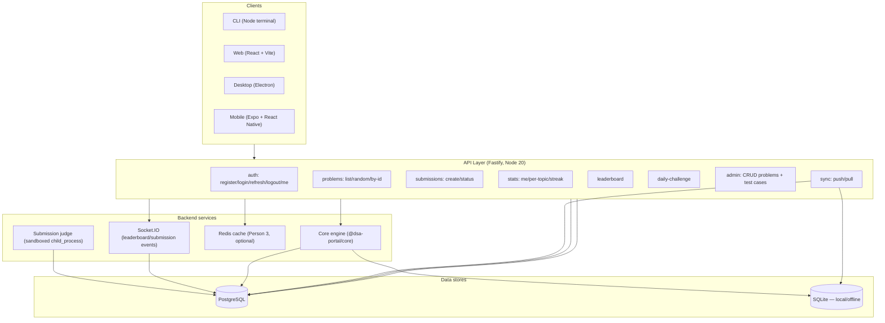
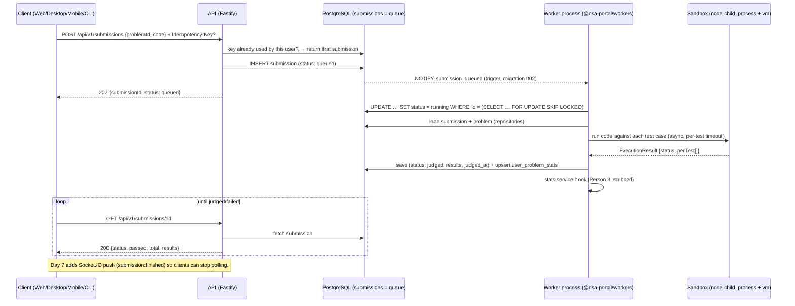
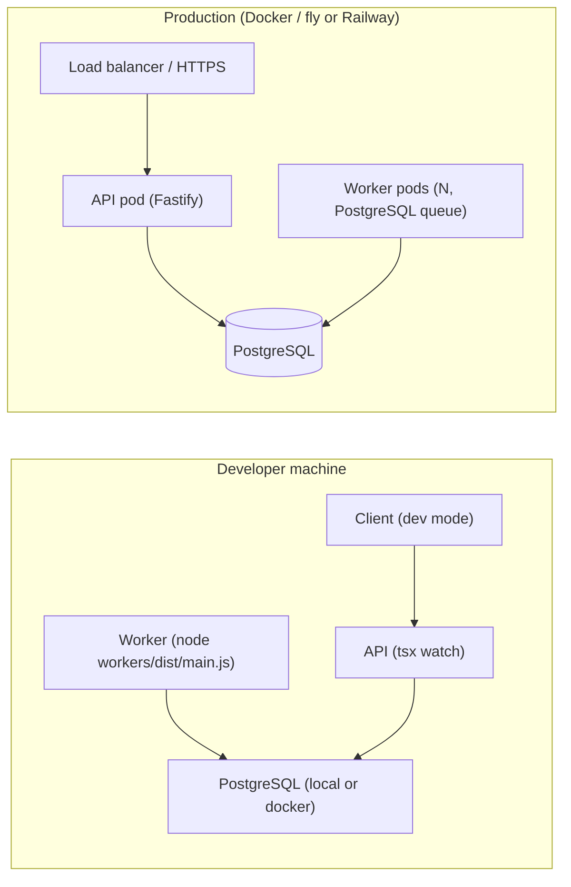

# DSA Practice Platform — Architecture

## 1. Component diagram

## 2. Sequence diagram — submit → queue → worker → sandbox → result → client

Day 5: the queue is the `submissions` table in PostgreSQL (no Redis). See CR-005.

**Why this is safe with several workers:** `FOR UPDATE SKIP LOCKED` hands each queued row to exactly one worker; `judgeSubmission` ignores rows that are already judged; the unique index `(user_id, idempotency_key)` stops duplicate POSTs even when retries race. If a NOTIFY is missed, workers still poll every `WORKER_POLL_MS`.

## 3. Deployment view

## 4. Modular monolith vs microservices — why this fits a 10-day project

We chose a **modular monolith with one separate worker process** rather than microservices.

**Modular monolith (API + core engine):**
- Single codebase, single deployable unit — one repo, one `npm install`, one test run. Critical for a 10-day, 3-person project where CI/CD setup time must be minimal.
- Shared in-memory types between `@dsa-portal/core`, `server`, and `workers` via npm workspaces — no API contracts between internal modules to version.
- Domain boundaries are enforced by folder ownership (Person 1/2/3) rather than network boundaries, so refactoring between modules is cheap.
- Downsides: a crash in one module can affect the whole process; scaling is coarse-grained. Acceptable for 10 days and modest user load.

**Separate worker process (PostgreSQL queue, since Day 5):**
- Submission judging runs untrusted user code in `child_process` sandboxes — CPU-heavy and potentially slow. Isolating it from the API keeps request latency low and lets the worker be restarted/scaled independently.
- PostgreSQL is the only cross-process bridge: the API inserts a `queued` row, workers claim rows with `FOR UPDATE SKIP LOCKED` and are woken by `LISTEN/NOTIFY`. One less service to run; the job and its result live in the same transactional store. Trade-off: no built-in retries/dashboards like BullMQ, so Day 6 adds retries, stalled-job recovery and metrics ourselves.

**Why not full microservices:**
- 10 days is too short to design, containerize, orchestrate, and observe 6–8 independent services, plus handle service discovery, retries, circuit breakers, and distributed tracing.
- Network boundaries between `problems`, `submissions`, `stats`, etc. would slow development and add failure modes the team can't afford to debug.

**Trade-off summary:** Monolith for development speed and shared types; separate worker for CPU isolation; the PostgreSQL submissions table as the single async bridge. Re-evaluate service splits only after the MVP ships.

## 5. Stack & folder ownership

**Stack:** Node 20, TypeScript, Fastify, zod, pino, PostgreSQL (server), SQLite via better-sqlite3 (local/offline), Redis + BullMQ, Socket.IO, JWT + bcrypt, React + Vite, Monaco editor, Zustand, Recharts, Electron, Expo, Jest/Vitest, Playwright, Docker, GitHub Actions.

**Folder ownership (hard rule — edit only your own folders):**
- Person 1: `/core` (excl. `storage`/`sync`), `/server/src/app.ts`, `/server/src/modules/{problems,hints,solutions,submissions,realtime,leaderboard,daily}`, `/workers`, `/docs/architecture.md`, `/docs/openapi.yaml`, `/docs/websocket-events.md`.
- Person 2: `/server/src/db`, `/server/src/sync`, `/core/src/storage`, `/core/src/sync`, `/infra`, `/scripts`, `/.github`, `/docs/db`, `/docs/infra`, docker files.
- Person 3: `/web`, `/desktop`, `/mobile`, `/ui-core`, `/server/src/modules/{auth,admin,stats}`, `/server/src/cache`, `/docs/design`.

**Contract:** OpenAPI at `/docs/openapi.yaml` is the source of truth for `/api/v1`. Never change an agreed endpoint, table column, or WebSocket event directly — propose in `/docs/CHANGE_REQUESTS.md`.
